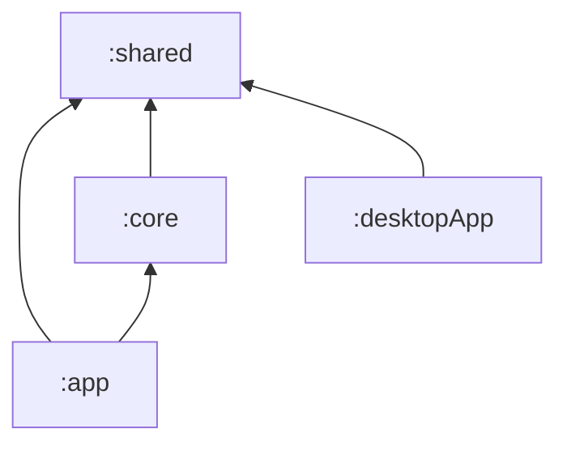

# Architecture & Code Organization

This document covers the module boundaries and where new code goes.

## Modules

| Module        | Type                  | Responsibility                                                     |
| ------------- | --------------------- | ------------------------------------------------------------------ |
| `:app`        | Android application   | Compose UI, DataStore, WorkManager, device integration             |
| `:shared`     | KMP library           | Cross-platform core: database, Ktor client, calculators, constants |
| `:core`       | Android library       | OCR engine: ONNX Runtime, OpenCV, image-hash database              |
| `:desktopApp` | JVM + Compose Desktop | Single-file prototype on top of `:shared`                          |

Dependencies point one way only:

## How the seams are drawn

- Modules follow platform seams, not features. Features go into packages.
- Logic that is not platform-specific goes in `:shared`. For platform differences, use `expect`/`actual`.
- Android framework code (DataStore, WorkManager, notifications, Android-only Compose) stays in `:app`. OCR engine code (ONNX Runtime, OpenCV,
  the image-hash database) belongs in `:core`; `:app` keeps the glue that feeds it from Android — screenshots, file URIs, the OCR queue.

## Where new code goes

| You are adding…                      | It goes in…                                                            |
| ------------------------------------ |------------------------------------------------------------------------|
| A screen, dialog, or composable      | `app` → `ui/`. Rules in [`app/AGENTS.md`](app/AGENTS.md)               |
| Cross-platform business logic / math | `shared` → `core/calculators/` or a new `core/` package                |
| An Arcaea domain constant or enum    | `shared` → `core/constants/`                                           |
| A Room entity / DAO / repository     | `shared` → `core/database/`                                            |
| A parser for an external game format | `shared` → `core/database/externals/`                                  |
| A preference                         | `app` → `datastore/`, one file per store                               |
| A background job                     | `app` → `jobs/` as `XxxJob`, registered via `worker<T>()`              |
| OCR inference / image processing     | `core` → `ocr/`                                                        |
| A platform API behind shared code    | `shared` → `expect` in commonMain, actuals in `androidMain`, `jvmMain` |

If a candidate location is not listed, start from the module whose dependencies it needs, then from the package whose existing files it most
resembles. Do not create new top-level packages in `:app` without discussion.
